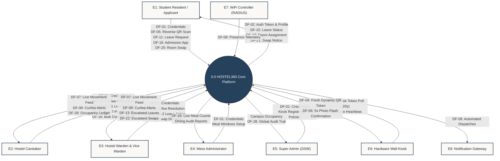
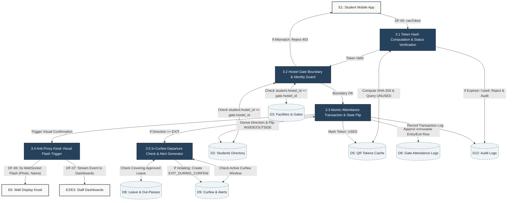
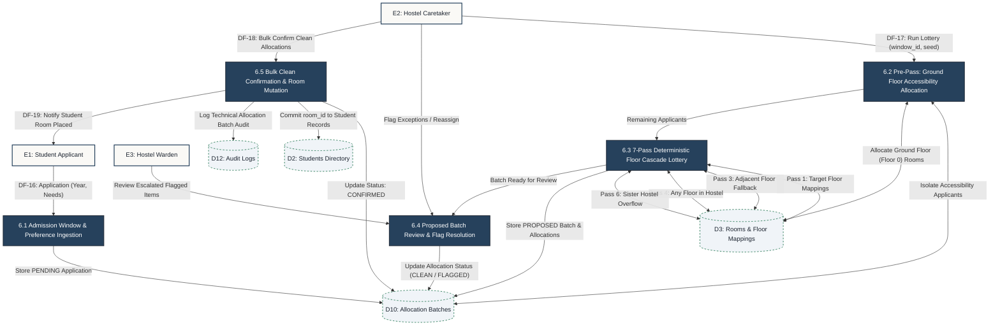

# HOSTEL360 — Complete Data Flow Diagram (DFD) Specification

> **Document Version:** 2.0.0  
> **Target System:** HOSTEL360 — Reverse Dynamic QR Attendance, Curfew Rule Engine & 7-Pass Room Allocation Platform  
> **Institution:** Maulana Azad National Institute of Technology (MANIT), Bhopal  
> **Standards Reference:** Yourdon & DeMarco / Gane & Sarson DFD Notations  
> **Companion Documents:** [ARCHITECTURE.md](file:///f:/Hostel360/docs/ARCHITECTURE.md), [DATA_DICTIONARY.md](file:///f:/Hostel360/docs/DATA_DICTIONARY.md), [FEATURES.md](file:///f:/Hostel360/docs/FEATURES.md)

---

## 1. System Overview & Scope Boundary

**HOSTEL360** is an enterprise campus residential security and administration system designed for MANIT Bhopal across 12 hostels (H1 to H12, Boys and Girls) and multiple central dining facilities. 

The digital platform replaces paper registers, fixed barcode cards, and proxy-vulnerable biometric scanners with:
1. **Continuous 24/7 Reverse Dynamic QR Attendance:** Unattended wall-mounted kiosks continuously cycle 32-byte cryptographic SHA-256 tokens every 20 seconds. Students scan the kiosk QR using their personal mobile app.
2. **On-Site Anti-Proxy Visual Confirmation Flash:** Upon a valid scan, the wall kiosk flashes the scanning student’s photo, name, and direction (`ENTRY` / `EXIT` or `MEAL_CLAIMED`) for 5 seconds over WebSockets.
3. **Continuous Background Curfew Rule Sweeper:** Automated cron jobs evaluate student movements against overnight curfew windows without blocking physical gate scans.
4. **Offline 7-Pass Room Lottery Allocation Engine:** Handled by hostel Caretakers and overseen by Wardens to place new admits and continuing residents across room tiers and floors.
5. **Tiered Out-Pass & Leave Approval:** Ground-level Caretakers approve low-risk single-day leave; high-risk multi-day leaves escalate to Wardens.

---

## 2. External Entities (Sources & Sinks)

External entities are actors, hardware terminals, or external systems outside the software boundary that supply data to (sources) or receive data from (sinks) the HOSTEL360 system.

| Entity ID | Entity Name | Classification | Primary Interface | Core Responsibilities |
|---|---|---|---|---|
| **E1** | **Student** | Human Actor | Progressive Web App (`/app/*`) | <ul><li>Presents login credentials to access mobile app</li><li>Scans kiosk dynamic QR codes using mobile camera</li><li>Submits overnight/weekend leave and emergency out-pass requests</li><li>Applies for hostel admissions & selects room preferences</li><li>Initiates, accepts, or rejects mutual room swap requests with peers</li><li>Views own attendance logs, curfew status, and mess counts</li></ul> |
| **E2** | **Hostel Caretaker** | Human Actor | Operations Console (`/dashboard/*`) | <ul><li>Supervises day-to-day hostel occupancy and ground movements</li><li>Reviews, runs, and confirms 7-pass batch room lotteries for their hostel</li><li>Approves Level-1 (Tier-1 Low-Risk) leave applications and day passes</li><li>Manages student room corrections and manual placements</li><li>Physically monitors wall kiosk terminals and triggers software reboots</li><li>Afield verification of curfew alerts (calls parent/student)</li></ul> |
| **E3** | **Hostel Warden & Vice Warden** | Human Actor | Administrative Console (`/dashboard/*`) | <ul><li>Official administrative disciplinary authority for assigned hostel</li><li>Approves Level-2 (High-Risk multi-day / overnight) leave requests</li><li>Reviews and formally decides on mutual student room swap requests</li><li>Resolves open curfew violation alerts with mandatory audit notes</li><li>Monitors hostel occupancy percentages and curfew safety feeds</li><li>Oversees escalated unallocated lottery applications from Caretaker</li></ul> |
| **E4** | **Mess Administrator / Manager** | Human Actor | Mess Management Console (`/dashboard/mess/*`) | <ul><li>Supervises campus mess operations and dining counters</li><li>Maintains meal service schedules (Breakfast, Lunch, Snacks, Dinner)</li><li>Monitors live meal consumption counters and prevents double-dipping</li><li>Generates dining attendance and dietary audit reports</li></ul> |
| **E5** | **Super Admin / DSW (Dean of Student Welfare)** | Human Actor | Global Governance Console (`/dashboard/*`) | <ul><li>Campus-wide institutional oversight over all 12 Hostels (H1–H12)</li><li>Provisions hardware wall kiosks and manages device secrets</li><li>Sets campus-wide curfew policies, academic sessions, and floor mappings</li><li>Conducts staff nominations, assignments, and account revocations</li><li>Audits immutable system-wide security, auth, and scanning logs</li></ul> |
| **E6** | **Hardware Wall Kiosk / Display Terminal** | IoT Hardware Entity | Wall Display Client (`/display/gate/:id`, `/display/mess/:id`) | <ul><li>Mounted tablet/monitor at hostel gates and mess entrances</li><li>Polls/receives dynamic QR tokens with 20-second TTL</li><li>Renders clear, high-contrast QR codes with 1-second countdown ring</li><li>Subscribes to Socket.IO device room (`device:<id>`)</li><li>Flashes full-screen 5-second student photo and attendance confirmation</li><li>Transmits automated periodic hardware heartbeats to backend</li></ul> |
| **E7** | **Campus WiFi Controller / RADIUS Server** | External Integration | REST Ingestion Hook (`POST /api/curfew/presence-signals`) | <ul><li>External campus networking infrastructure (Aruba / Cisco ISE)</li><li>Emits advisory device association/disassociation telemetry</li><li>*Security Invariant:* Used strictly as an advisory check ("Last seen on WiFi: Xm ago"); NEVER modifies physical entry/exit state or curfew alerts</li></ul> |
| **E8** | **Notification & Real-Time Relay Gateway** | System Service Sink | Socket.IO Server / SMS / Email Webhook | <ul><li>Pushes real-time room occupancy and gate scan events to active dashboards</li><li>Emits visual confirmation triggers to physical gate kiosks</li><li>Dispatches overnight absence notifications to parents and Wardens</li></ul> |

---

## 3. Data Stores (Repositories / Persistence)

Data stores represent persistent relational tables managed by MySQL / TiDB via Prisma ORM.

| Store ID | Data Store Name | Database Tables | Description & Stored Attributes |
|---|---|---|---|
| **D1** | **User Accounts & Staff Assignments** | `users`, `refresh_tokens`, `staff_hostel_assignments`, `staff_mess_assignments` | Stores hashed user credentials (bcrypt), contact details, active JWT refresh tokens, and active staff role assignments to hostels or messes. |
| **D2** | **Student Master Directory** | `students` | Student roll numbers, academic programs, current year of study, gender, guardian contact information, room binding (`room_id`), and real-time state (`current_state: INSIDE / OUTSIDE`). |
| **D3** | **Campus Facilities & Physical Topology** | `hostels`, `rooms`, `gates`, `floor_year_mappings` | Hostel details (H1–H12, Boys/Girls), room numbers, bed capacities, operational status, physical gate names, and floor-to-academic-year affinities. |
| **D4** | **Hardware Kiosks & Gateway Devices** | `devices` | Registered wall monitors and kiosks, hardware codes (`H1_GATE_MAIN`), purpose (`GATE` / `MESS`), bcrypt device secret hashes, and `last_heartbeat_at`. |
| **D5** | **Dynamic QR Tokens Cache** | `qr_tokens` | Active and burned dynamic tokens, 32-byte raw token SHA-256 hashes, device binding, 20s expiration timestamps (`expires_at`), and status (`UNUSED`, `USED`, `EXPIRED`, `REVOKED`). |
| **D6** | **Hostel Gate Attendance Logs** | `hostel_attendance` | Permanent, immutable ledger of all physical hostel gate crossings: `student_id`, `gate_id`, `direction` (`ENTRY` / `EXIT`), timestamp, and linked `qr_token_id`. |
| **D7** | **Dining Facilities & Meal Scans** | `messes`, `meal_windows`, `mess_attendance` | Mess hall definitions, scheduled meal windows (times & meal types), and historical meal consumption records preventing duplicate claims. |
| **D8** | **Tiered Leave & Out-Passes** | `leave_requests` | Formal student out-pass applications: dates, reasons, destination, risk tier (`LOW` / `HIGH`), review status (`PENDING`, `APPROVED`, `REJECTED`), and reviewer notes. |
| **D9** | **Curfew Policies, Alerts & Telemetry** | `curfew_windows`, `curfew_alerts`, `device_presence_signals` | Daily/weekend curfew time rules, automated curfew violation alerts (`OVERNIGHT_NOT_RETURNED`, `EXIT_DURING_CURFEW`), resolution audit notes, and network telemetry. |
| **D10** | **Admissions & 7-Pass Allocation Engine** | `registration_windows`, `hostel_applications`, `allocation_batches`, `room_allocations` | Active admission windows, student room applications, offline batch lottery runs with deterministic audit seeds, 7-pass cascade steps, and proposed/confirmed assignments. |
| **D11** | **Mutual Room Swap Negotiations** | `room_swap_requests` | Student-initiated mutual room exchanges: sender, receiver, swap reasons, peer acceptance status, and Warden administrative approvals. |
| **D12** | **Technical Security & Audit Trail** | `audit_logs` | Immutable audit log: actor ID, actor type (`USER`, `DEVICE`, `SYSTEM`), action, target entity, client IP address, user agent, and contextual JSON metadata. |

---

## 4. Processes (Functional Transformations)

Processes transform incoming data flows into outgoing data flows and data store mutations.


---

### Detailed Process Specifications

#### Process 1.0: Identity, Access Control & Staff Assignment Management
* **Owner / Entity:** Super Admin (E5), All Users (E1, E2, E3, E4)
* **Function:** Authenticates users via email and bcrypt password hashes, issues short-lived 15-minute JWT access tokens and 7-day cryptographically rotating refresh tokens with breach reuse detection, and resolves hostel/mess role scoping.
* **Inputs:** Email, password, refresh token.
* **Outputs:** Auth access token, user profile, role-scoped permissions, session termination.
* **Data Stores Accessed:** Read/Write `D1: Users & Assignments`, Write `D12: Audit Logs`.

#### Process 2.0: Dynamic QR Token Generation & Kiosk Sync
* **Owner / Entity:** Hardware Wall Kiosk (E6), Caretaker (E2)
* **Function:** Wall display kiosk requests a rotating dynamic QR code every 20 seconds. Process invalidates prior `UNUSED` tokens for the device, generates a 32-byte opaque cryptographically random string, stores its SHA-256 hash in database with a 20s TTL, and updates device heartbeat.
* **Inputs:** Device ID/code, HTTP polling or manual refresh trigger.
* **Outputs:** 32-byte raw token, expiration timestamp, active meal window info.
* **Data Stores Accessed:** Read `D4: Kiosks & Gateways`, Write `D5: QR Tokens Cache`, Write `D4: Kiosks & Gateways (heartbeat)`.

#### Process 3.0: Reverse QR Scan Ingestion & Validation
* **Owner / Entity:** Student (E1), Hardware Wall Kiosk (E6)
* **Function:** Student app scans on-screen QR code and posts raw token. Process computes SHA-256 hash, executes atomic database transaction: verifies token exists, is `UNUSED`, is not expired, checks hostel boundary (gate hostel == student hostel), marks token `USED`, derives direction from `student.current_state` (`INSIDE` $\rightarrow$ `EXIT`, `OUTSIDE` $\rightarrow$ `ENTRY`), updates `current_state`, creates `hostel_attendance` record, checks active curfew window, and triggers WebSocket anti-proxy confirmation flash to the physical kiosk for 5 seconds.
* **Inputs:** Scanned raw QR token string, student bearer JWT token.
* **Outputs:** Attendance confirmation (`ENTRY`/`EXIT`), student state update, real-time Socket.IO kiosk flash event (`display:confirm`: student photo, name, roll number).
* **Data Stores Accessed:** Read/Write `D5: QR Tokens Cache`, Read/Write `D2: Students Directory`, Read `D3: Facilities & Rooms`, Write `D6: Gate Attendance Logs`, Read `D8: Leave & Out-Passes`, Read/Write `D9: Curfew & Alerts`, Write `D12: Audit Logs`.

#### Process 4.0: Curfew Rule Sweeper & Alert Lifecycle
* **Owner / Entity:** System Scheduler, Caretaker (E2), Warden (E3)
* **Function:** Automated background engine runs two jobs:
  1. **Job A (Window Start Sweep):** Sweeps students with `current_state = 'OUTSIDE'`, checks if covered by approved `leave_requests`, waits grace period, and creates `OVERNIGHT_NOT_RETURNED` curfew alert (`OPEN`).
  2. **Job B (Exit During Active Curfew):** Atomically triggered during physical scan if student performs an `EXIT` during active curfew without an approved emergency out-pass, creating an `EXIT_DURING_CURFEW` alert (`OPEN`).
  Staff review open alerts, record call verification notes, and resolve them (`RESOLVED`).
* **Inputs:** Curfew window definitions, cron triggers, resolution notes from staff.
* **Outputs:** Open curfew alerts, Socket.IO dashboard alerts, parent alert dispatches, alert resolutions.
* **Data Stores Accessed:** Read `D9: Curfew & Alerts`, Read `D2: Students Directory`, Read `D8: Leave & Out-Passes`, Write `D9: Curfew & Alerts (alerts)`, Write `D12: Audit Logs`.

#### Process 5.0: Tiered Out-Pass & Leave Verification
* **Owner / Entity:** Student (E1), Caretaker (E2), Warden (E3)
* **Function:** Enforces institutional leave tiering:
  * **Tier 1 (Low-Risk):** Single-day out-passes or day departures returning before curfew $\rightarrow$ Approved by Caretaker (E2).
  * **Tier 2 (High-Risk):** Multi-day leaves, overnight stays, or departures exceeding curfew limits $\rightarrow$ Escalates to Hostel Warden (E3).
  Approved leaves automatically exempt students from Curfew Sweeper (Process 4.0).
* **Inputs:** Student leave application (dates, reason, destination), Caretaker/Warden decision (Approve/Reject).
* **Outputs:** Approved/rejected leave status, curfew exemption authorization.
* **Data Stores Accessed:** Write `D8: Leave & Out-Passes`, Read `D2: Students Directory`, Write `D12: Audit Logs`.

#### Process 6.0: Admission & 7-Pass Room Allocation Engine
* **Owner / Entity:** Student (E1), Caretaker (E2), Warden (E3)
* **Function:** Handles hostel admissions and room allotment via an audit-reproducible 7-pass cascade engine:
  * **Pass 1:** Target Floor Preference based on year of study (`floor_year_mappings`).
  * **Pass 2:** Ground Floor Accessibility Pre-Pass for students with physical needs.
  * **Pass 3:** Adjacent Floor Fallback (target floor $\pm 1$).
  * **Pass 4:** Any Available Floor in same hostel.
  * **Pass 5:** Clean Proposals vs Flagged/Review Items (cross-gender check, capacity).
  * **Pass 6:** Redirect to sister hostel if capacity exhausted.
  * **Pass 7:** Caretaker bulk-confirms clean allocations; escalated items reviewed with Warden.
* **Inputs:** Registration window parameters, student hostel applications, Caretaker batch execution command with optional lottery seed.
* **Outputs:** Proposed allocation batches, audit report, confirmed student room assignments.
* **Data Stores Accessed:** Read `D3: Facilities & Rooms`, Read/Write `D10: Allocations & Batches`, Write `D2: Students Directory (room_id)`, Write `D12: Audit Logs`.

#### Process 7.0: Mutual Room Swap Negotiation & Execution
* **Owner / Entity:** Student A (E1), Student B (E1), Warden (E3)
* **Function:** Student A proposes a mutual room swap with Student B. Student B receives notification and accepts/rejects. Upon peer acceptance, the request escalates to the Hostel Warden (`ESCALATED_TO_WARDEN`). The Warden reviews academic records and approves/rejects. Upon approval, an atomic transaction exchanges `room_id` in `D2` for both students simultaneously.
* **Inputs:** Target student roll number, swap reason, peer acceptance, Warden approval.
* **Outputs:** Swap status updates, atomic room reassignment in student profiles.
* **Data Stores Accessed:** Read/Write `D11: Room Swap Requests`, Read/Write `D2: Students Directory`, Read `D3: Facilities & Rooms`, Write `D12: Audit Logs`.

#### Process 8.0: Dining Attendance & Quota Validation
* **Owner / Entity:** Student (E1), Mess Administrator (E4), Kiosk (E6)
* **Function:** Kiosks at dining hall entrances display rotating meal QR tokens linked to active `meal_windows` (Breakfast, Lunch, Snacks, Dinner). When a student scans, the system verifies student is assigned to this mess, ensures no duplicate claim has been recorded for the same student in the same meal window, records `mess_attendance`, increments live dining counters, and flashes meal confirmation on the kiosk.
* **Inputs:** Scanned meal QR token, student credentials.
* **Outputs:** Meal claim confirmation, duplicate claim rejection, live mess count update.
* **Data Stores Accessed:** Read `D5: QR Tokens Cache`, Read/Write `D7: Mess & Meal Windows`, Read `D2: Students Directory`, Write `D12: Audit Logs`.

#### Process 9.0: Campus Audit Trail & Analytics Reporting
* **Owner / Entity:** Super Admin (E5), Warden (E3), Caretaker (E2)
* **Function:** Aggregates gate movement records, hourly occupancy percentages, curfew violation metrics, device hardware health, and security audit logs into downloadable CSV reports and live analytics dashboards.
* **Inputs:** Date range filters, hostel selector, export requests.
* **Outputs:** Occupancy charts, curfew analytics, exportable CSV movement ledgers.
* **Data Stores Accessed:** Read `D6: Gate Attendance Logs`, Read `D2: Students Directory`, Read `D7: Mess & Meal Windows`, Read `D9: Curfew & Alerts`, Read `D4: Kiosks & Gateways`, Read `D12: Audit Logs`.

---

## 5. Comprehensive Data Flows Matrix

| Flow ID | Flow Name | Source | Destination | Data Elements Carried | Frequency / Trigger |
|---|---|---|---|---|---|
| **DF-01** | Login Request | E1, E2, E3, E4, E5 | Process 1.0 | Email, password hash, device client info | On demand (user login) |
| **DF-02** | Auth Tokens & Scope | Process 1.0 | E1, E2, E3, E4, E5 | JWT Access Token, Refresh Token, User Profile, Role Permissions | Successful auth |
| **DF-03** | Kiosk QR Poll Request | E6 (Wall Kiosk) | Process 2.0 | Device ID, device code, optional authorization header | Periodic (every 20s) |
| **DF-04** | Fresh Dynamic QR Token | Process 2.0 | E6 (Wall Kiosk) | 32-byte opaque token, expiration timestamp, active meal window | Periodic response (every 20s) |
| **DF-05** | Gate Scan Submission | E1 (Student App) | Process 3.0 | 32-byte raw token string, student bearer token | Student gate scan |
| **DF-06** | Anti-Proxy Confirmation Flash | Process 3.0 | E6 (Wall Kiosk) | Student name, roll number, photo URL, direction (`ENTRY`/`EXIT`), timestamp | Real-time WebSocket (<100ms) |
| **DF-07** | Live Movement Stream | Process 3.0 | E2, E3, E5 | Student name, roll number, gate name, movement direction, timestamp | Real-time WebSocket to dashboards |
| **DF-08** | Presence Telemetry | E7 (WiFi Server) | Process 4.0 | Device MAC, IP, association/disassociation event, timestamp | Periodic / Event-driven webhook |
| **DF-09** | Curfew Alert Notification | Process 4.0 | E2, E3, E8 | Student details, alert type, overdue time, guardian contact | Cron job trigger / Scan event |
| **DF-10** | Curfew Alert Resolution | E2, E3 | Process 4.0 | Alert ID, resolution action, mandatory review note | Staff manual review |
| **DF-11** | Leave / Out-Pass Request | E1 (Student) | Process 5.0 | Start date, end date, reason, destination, emergency contact | Student submission |
| **DF-12** | Tier-1 Leave Decision | E2 (Caretaker) | Process 5.0 | Request ID, action (`APPROVED`/`REJECTED`), caretaker remarks | Caretaker review |
| **DF-13** | Tier-2 Leave Escalation | Process 5.0 | E3 (Warden) | High-risk multi-day request details, risk tier flag | Automated rule evaluation |
| **DF-14** | Tier-2 Leave Decision | E3 (Warden) | Process 5.0 | Request ID, action (`APPROVED`/`REJECTED`), warden remarks | Warden review |
| **DF-15** | Leave Status Update | Process 5.0 | E1 (Student) | Request status, approved dates, official pass badge | Immediate on decision |
| **DF-16** | Hostel Admission Application | E1 (Student) | Process 6.0 | Academic program, year, gender, accessibility needs, floor preference | Admission window open |
| **DF-17** | Execute Batch Lottery | E2 (Caretaker) | Process 6.0 | Window ID, hostel ID, audit lottery seed | Caretaker lottery run trigger |
| **DF-18** | Allocation Review & Bulk Confirm | E2, E3 | Process 6.0 | Batch ID, clean confirmations, review notes for exceptions | Caretaker/Warden review |
| **DF-19** | Room Allocation Notification | Process 6.0 | E1 (Student) | Allocated room number, floor, hostel wing, check-in instructions | Batch confirmation |
| **DF-20** | Room Swap Proposal | E1 (Student A) | Process 7.0 | Target student roll number, current room, proposed room, swap reason | Student initiated |
| **DF-21** | Peer Acceptance / Rejection | E1 (Student B) | Process 7.0 | Swap request ID, peer decision (`ACCEPT`/`REJECT`) | Peer counter-action |
| **DF-22** | Swap Escalation to Warden | Process 7.0 | E3 (Warden) | Swap ID, both student profiles, current rooms, swap reasons | Automated on peer acceptance |
| **DF-23** | Swap Administrative Decision | E3 (Warden) | Process 7.0 | Swap ID, Warden approval/rejection, formal note | Warden review |
| **DF-24** | Mess Meal Scan Submission | E1 (Student App) | Process 8.0 | Scanned meal QR token, student bearer token | Student dining scan |
| **DF-25** | Meal Claim Visual Flash | Process 8.0 | E6 (Mess Kiosk) | Student name, roll number, photo URL, meal type (`LUNCH`), claim status | Real-time WebSocket |
| **DF-26** | Dining Quota Counter Update | Process 8.0 | E4 (Mess Admin) | Real-time count of meals served per active meal window | Real-time WebSocket |
| **DF-27** | Report Export Request | E2, E3, E5 | Process 9.0 | Date range, hostel filter, movement direction, report format | Staff report generation |
| **DF-28** | Analytics & CSV Ledger Output | Process 9.0 | E2, E3, E5 | Aggregated occupancy metrics, gate movement CSV ledger, curfew audit | Immediate download / UI display |

---

## 6. Diagrammatic DFD Models

### 6.1 Level 0: Context Diagram

The Context Diagram defines the system boundary, showing the entire HOSTEL360 application as a single process interacting with all external entities.



---

### 6.2 Level 1: Subsystem Data Flow Diagram

Decomposes the platform into the 9 core functional processes and maps all interactions with external entities and relational data stores.

```mermaid
flowchart TB
  classDef entity fill:#FAF9F6,stroke:#26415C,stroke-width:2px,color:#1C2430;
  classDef process fill:#26415C,stroke:#1C2430,stroke-width:1.5px,color:#FFFFFF;
  classDef datastore fill:#F0F4F8,stroke:#2E7D5B,stroke-width:1.5px,stroke-dasharray: 4 4,color:#1C2430;

  E1["E1: Student"]:::entity
  E2["E2: Caretaker"]:::entity
  E3["E3: Warden"]:::entity
  E4["E4: Mess Admin"]:::entity
  E5["E5: Super Admin"]:::entity
  E6["E6: Wall Kiosk"]:::entity

  P1["1.0 Identity & Access Control"]:::process
  P2["2.0 Dynamic QR Token Generation"]:::process
  P3["3.0 Reverse QR Scan Processing"]:::process
  P4["4.0 Curfew Rule Sweeper"]:::process
  P5["5.0 Tiered Leave Management"]:::process
  P6["6.0 7-Pass Room Allocation Engine"]:::process
  P7["7.0 Mutual Room Swap Engine"]:::process
  P8["8.0 Dining Attendance Tracking"]:::process
  P9["9.0 Audit Trail & Analytics"]:::process

  D1[("D1: Users & Auth")]:::datastore
  D2[("D2: Students Master")]:::datastore
  D3[("D3: Facilities & Rooms")]:::datastore
  D4[("D4: Kiosks & Hardware")]:::datastore
  D5[("D5: QR Tokens Cache")]:::datastore
  D6[("D6: Gate Attendance")]:::datastore
  D7[("D7: Mess & Meal Windows")]:::datastore
  D8[("D8: Leave Requests")]:::datastore
  D9[("D9: Curfew & Alerts")]:::datastore
  D10[("D10: Allocation Batches")]:::datastore
  D11[("D11: Room Swaps")]:::datastore
  D12[("D12: Security Audit Logs")]:::datastore

  %% Subsystem 1: Auth
  E1 & E2 & E3 & E4 & E5 -->|Credentials| P1
  P1 <-->|Verify / Store JWT| D1
  P1 -->|Log Auth Event| D12

  %% Subsystem 2: QR Token Issuance
  E6 -->|Poll Every 20s| P2
  P2 <-->|Check Device Secret / Heartbeat| D4
  P2 -->|Create 20s SHA-256 Token| D5
  P2 -->|Return 32-Byte Raw Token| E6

  %% Subsystem 3: Gate Scan Ingestion
  E1 -->|Submit Raw Token String| P3
  P3 <-->|Validate & Burn Token (USED)| D5
  P3 <-->|Check & Flip current_state| D2
  P3 -->|Append Physical Movement| D6
  P3 -->|DF-06: 5s Photo Flash Event| E6
  P3 -->|Check Curfew Window| D9
  P3 -->|Log Scan Transaction| D12

  %% Subsystem 4: Curfew Sweeper
  P4 <-->|Evaluate Overnight State| D2
  P4 <-->|Check Covering Leave| D8
  P4 -->|Create OPEN Alert| D9
  E2 & E3 -->|Resolve Alert with Notes| P4

  %% Subsystem 5: Leave
  E1 -->|Submit Leave Form| P5
  P5 -->|Store Application| D8
  E2 -->|Approve Tier-1 (Day Pass)| P5
  E3 -->|Approve Tier-2 (Overnight)| P5

  %% Subsystem 6: Room Allocation
  E1 -->|Submit Admission Preference| P6
  E2 -->|Run 7-Pass Lottery Engine| P6
  P6 <-->|Floor-Year Mappings & Capacity| D3
  P6 <-->|Propose Batches & Allocations| D10
  E2 & E3 -->|Confirm Clean Allocations| P6
  P6 -->|Write Student room_id| D2

  %% Subsystem 7: Room Swaps
  E1 -->|Initiate Swap Proposal| P7
  P7 <-->|Store & Validate Peer Swap| D11
  E3 -->|Warden Final Approval| P7
  P7 -->|Atomic Dual room_id Exchange| D2

  %% Subsystem 8: Mess Attendance
  E1 -->|Scan Dining Kiosk QR| P8
  P8 <-->|Validate Unused Meal Token| D5
  P8 <-->|Verify Active Window & 1-Meal Limit| D7
  P8 -->|Live Counter Update| E4
  P8 -->|Flash Meal Claimed| E6

  %% Subsystem 9: Analytics & Audit
  E2 & E3 & E5 -->|Generate Reports| P9
  P9 <-->|Aggregate Movements & Counts| D6 & D7 & D9 & D12
```

---

### 6.3 Level 2 Decomposed DFDs

#### Sub-DFD 3.0: Reverse Dynamic QR Attendance Verification & Anti-Proxy Flash



---

#### Sub-DFD 6.0: 7-Pass Batch Room Lottery Allocation Engine (Caretaker Handled)



---

## 7. Entity Responsibility RACI Matrix

The following matrix clarifies the exact operational accountability for every system process:
* **R (Responsible):** The entity that executes the process or task.
* **A (Accountable):** The entity with final institutional authority and veto power.
* **C (Consulted):** The entity providing required input data or bilateral negotiation.
* **I (Informed):** The entity receiving system notifications, status changes, or telemetry.

| Process Description | E1: Student | E2: Caretaker | E3: Warden | E4: Mess Admin | E5: Super Admin | E6: Kiosk | E7: WiFi | E8: Gateway |
|---|:---:|:---:|:---:|:---:|:---:|:---:|:---:|:---:|
| **1.0 User Auth & Session Security** | R | R | R | R | **A** | I | - | - |
| **2.0 Kiosk 20s Dynamic QR Generation** | - | C | I | - | **A** | **R** | - | - |
| **3.0 Reverse QR Gate Scan & State Flip** | **R** | I | I | - | A | **I (Flash)** | - | I |
| **4.0 Curfew Window Sweep & Alert Resolve** | I | **R** | **A** | - | I | - | C (Hint) | I |
| **5.1 Tier-1 Leave Approval (Day Out-Pass)** | C | **R / A** | I | - | - | - | - | I |
| **5.2 Tier-2 Leave Approval (Overnight)** | C | C | **R / A** | - | - | - | - | I |
| **6.1 Student Admission Room Application** | **R** | I | I | - | A | - | - | - |
| **6.2 Run 7-Pass Room Allocation Engine** | I | **R** | **A** | - | I | - | - | - |
| **6.3 Bulk Confirm Clean Room Allocations** | I | **R** | **A** | - | I | - | - | I |
| **7.1 Propose Mutual Room Swap** | **R** | I | I | - | - | - | - | I |
| **7.2 Peer Acceptance / Counter-Action** | **R** | I | I | - | - | - | - | I |
| **7.3 Review & Execute Room Swap** | I | C | **R / A** | - | - | - | - | I |
| **8.0 Dining Attendance & Quota Scans** | **R** | - | - | **A** | I | **I (Flash)** | - | I |
| **9.0 Audit Trail, Analytics & Exports** | - | R | R | R | **A** | - | - | - |

---

## 8. Verification & Summary

1. **Reverse QR Attendance & Anti-Proxy Flash:**
   * Students scan wall kiosk screens using their personal mobile cameras.
   * Real-time WebSockets trigger the 5-second student photo flash on the kiosk hardware (`display:confirm`) to prevent proxy attendance.
2. **Caretaker Autonomy in Room Allocation:**
   * Caretakers own the operational execution of the 7-pass cascade lottery (`runBatch`, `bulkConfirmClean`).
   * Wardens handle administrative oversight and escalated exceptions.
3. **Data Integrity & Consistency:**
   * All 25 database tables and 19 Prisma enumerations are strictly accounted for in data stores `D1` through `D12`.
   * Data flows follow standard Gane & Sarson / Yourdon & DeMarco notation, ready for diagram generation and thesis/presentation compilation.
